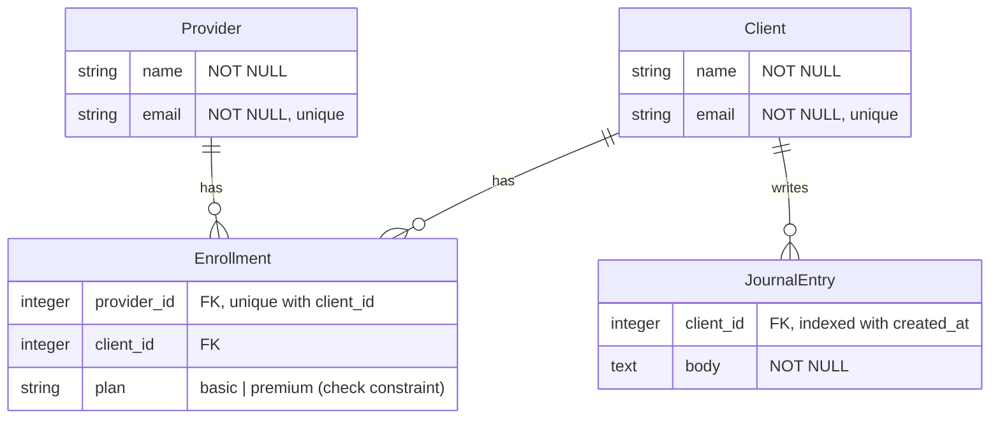

# Journal App

A small Rails 8.1 app modelling providers, clients, and client journal entries. Providers and clients have a many-to-many relationship through an `Enrollment`, which records the client's plan (`basic` or `premium`) with that provider. Clients post free-text journal entries. The focus is the data model and four ActiveRecord queries. A minimal server-rendered page lets you view a client's journal and post to it.

## Quick start (Docker, recommended for reviewers)

Requires only Docker. Works on Apple Silicon and x86_64.

```bash
docker compose up --build
```

Then open http://localhost:3000. The database is created and seeded on startup.

Run the test suite inside the container:

```bash
docker compose run --rm -e RAILS_ENV=test web bash -c "bin/rails db:prepare && bin/rspec"
```

Code is copied into the image (not mounted), so rebuild with `--build` after changing code.

## Native setup

1. Install the Ruby version in [`.ruby-version`](.ruby-version) with a version manager such as [mise](https://mise.jdx.dev) or rbenv. macOS's built-in Ruby is too old.
2. Then:

```bash
bin/setup --skip-server   # install gems, prepare the database
bin/rails db:seed         # demo data
bin/dev                   # http://localhost:3000
```

## Schema



## The four queries

```ruby
provider.clients                          # 1. All clients for a given provider
client.providers                          # 2. All providers for a given client
client.journal_entries.recent_first       # 3. A client's journal entries, newest first
provider.journal_entries.recent_first     # 4. Entries across all of a provider's clients, newest first
```

1 and 2 are `has_many :through :enrollments`. 4 is `has_many :journal_entries, through: :clients`, which joins enrollments → clients → journal_entries. `recent_first` orders by `created_at DESC, id DESC` (the `id` keeps ties stable). All four are tested in [`spec/models/queries_spec.rb`](spec/models/queries_spec.rb).

Try them in `bin/rails console` after seeding. `bin/rails db:seed` prints example commands.

## Checks

Run everything with:

```bash
bin/ci
```

Steps (configured in [`config/ci.rb`](config/ci.rb)):

- **Setup**: `bin/setup`: installs gems and prepares the database.
- **Style: Ruby**: RuboCop with the Rails omakase rules.
- **Security: Gem audit**: bundler-audit checks gems for known CVEs.
- **Security: Importmap audit**: checks pinned JavaScript packages for known vulnerabilities.
- **Security: Brakeman**: static analysis of the Rails code for security issues.
- **Tests: RSpec**: model, request, and system specs (system specs use `rack_test`, so no browser is needed).
- **Tests: Seeds**: runs `db/seeds.rb` in the test environment to make sure it still works.

GitHub Actions runs the same checks, with specs on Ubuntu and macOS plus a job that runs the specs inside the Docker image.

## Design notes

- [Architecture decision records](docs/decisions/): why the app is shaped this way (join model, string enum, ordering, SQLite, no auth, and more).
- [Scaling notes](docs/scaling.md): what changes if the dataset gets very large.
